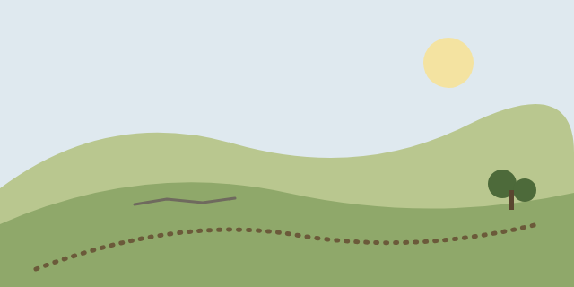
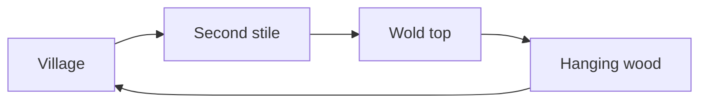

# Objects

An object is a part of a document that has more to it than a line of text: a table, a picture, a diagram. Each one below is already in place, drawn from the same walk as the other lessons, with a block that says how to change it, add another and take it away. Every object is plain text in this file, so nothing here is locked, and <kbd>⌘Z</kbd> undoes any step. Where a command has no key, its name is in bold: press <kbd>⌘K</kbd> with the caret on the object and choose it from the list.

The list for adding an object is the same everywhere: put the caret on an empty line, press <kbd>⌘K</kbd> and choose Insert object, then the name of the object.

> **Metadata.** The block at the very top of this file, with a title and a description, is its metadata. To change it, put the caret on it and press <kbd>↵</kbd>, or choose **Edit metadata** from <kbd>⌘K</kbd>; press <kbd>⌘↵</kbd> when you have finished. A file has only one, so Insert object then Metadata opens the one it has, and adds a new block at the top of a file that has none. To remove it, put the caret on it, press <kbd>⌘K</kbd> and choose **Delete metadata**.

## The table

| Stage | Miles | Stile |
| --- | --- | --- |
| Village to the second stile | 1 | Ladder |
| Second stile to the wold top | 2 | Two stones |
| The wood to the village | 1½ | None |

> **Table.** To edit it, put the caret in the table and press <kbd>↵</kbd>: the table opens as a grid, and <kbd>⌘↵</kbd> closes it again. Type over a cell, or press <kbd>⌘K</kbd> and choose **Column** and then **Insert column right**. To add another, choose Insert object and then Table. To remove it, put the caret on it, press <kbd>⌘K</kbd> and choose **Delete table**.

## The picture



> **Image.** The picture is a file in the assets folder beside this one, and the line above it names the file. To edit it, put the caret on the picture and press <kbd>↵</kbd>: its line opens as text, where you can change the description in the square brackets or the file in the round ones. To add another, choose Insert object and then **Image…** and pick a picture; WriteFlex copies it into assets. To remove it, put the caret on it, press <kbd>⌘K</kbd> and choose **Delete block**. The file stays in assets.

## The widgets

[Simulation: assets/walking-pace.html]

[Simulation: assets/packing-list.html]

> **Widget.** Each box is a small interactive page that lives in a file in assets. Click one to give it the keyboard, use it, and press the Esc key to hand the keyboard back to the text. To change what a widget does, edit its HTML file, which is a separate file in the folder. To add one, choose Insert object and then Widget…, or run **Insert widget…** from the command palette, and pick an HTML file from this folder or one below it. To remove one, delete its line, [Simulation: …], as you would any text; the file stays in assets.

## The code block

```
miles = 4 + 2 + 1
print(miles)
```

> **Code block.** To edit it, put the caret on the block and press <kbd>↵</kbd>; <kbd>⌘↵</kbd> closes it. To add another, choose Insert object and then **Code block**. To remove it, put the caret on it, press <kbd>⌘K</kbd> and choose **Delete block**. **Copy source** puts its text on the clipboard.

## The flow diagram



> **Flow diagram.** To edit it, put the caret on the diagram and press <kbd>↵</kbd>; the source opens with a live preview that follows as you type. To add another, choose Insert object and then **Flow diagram**, and pick the kind. To remove it, put the caret on it, press <kbd>⌘K</kbd> and choose **Delete block**.

## The mind map

```markmap
- The walk
  - Going up
    - Hedgerow
    - Stiles
  - On the wold
    - Walls
    - Weather
  - Coming down
    - Hanging wood
```

> **Mind map.** To edit it, put the caret on the map and press <kbd>↵</kbd>; the map opens as an outline you can type in, and <kbd>⇥</kbd> and <kbd>⇧⇥</kbd> move a line in and out a level. To add another, choose Insert object and then **Mind map**. To remove it, put the caret on it, press <kbd>⌘K</kbd> and choose **Delete block**.

## The drawing

```svg
<svg xmlns="http://www.w3.org/2000/svg" viewBox="0 0 320 120">
  <rect width="320" height="120" rx="10" fill="#f2f0ea"/>
  <path d="M10 100 L60 80 L110 60 L160 25 L210 45 L270 85 L310 100" fill="none" stroke="#b5532f" stroke-width="4" stroke-linejoin="round"/>
  <circle cx="160" cy="25" r="6" fill="#b5532f"/>
  <text x="160" y="14" font-size="11" text-anchor="middle" fill="#2b2a27">Wold top</text>
</svg>
```

> **SVG.** This is a profile of the walk, drawn in code. To edit it, put the caret on the drawing and press <kbd>↵</kbd>: the code opens with a live preview that redraws as you type. To add another, choose Insert object and then **SVG**. To remove it, put the caret on it, press <kbd>⌘K</kbd> and choose **Delete block**.

## The divider

The walk up is done. The walk down is shorter.

---

The wood is cool after the wold, and the path is soft underfoot.

> **Divider.** The line above is a divider: a line of three dashes on its own, which the editor sets apart in grey. There is nothing in it to edit. To add another, put the caret on an empty line, choose Insert object and then **Divider**. To remove it, delete its line as you would any text; <kbd>⌘Z</kbd> brings it back.

## The footnote

The second stile is the oldest on the route.[^1]

[^1]: It is cut from a single block of limestone, and the notch in its top rail was made for a dog.

> **Footnote.** The blue marker after the sentence is the footnote number, and the line under the paragraph is the note. To edit the note, click in its line and type. To add another, put the caret after the words it belongs to, choose Insert object and then **Footnote**, and write the note where the caret lands; the numbers are kept in order. To remove one, delete the marker and its note line.

## The reference

The old route over the wold is described in Hoskins, as every walker of it eventually finds. [⟨Hoskins 1955, p. 43⟩](zotero://select/library/items/HOSK1955)

> **Reference.** A reference is an ordinary link with the author and year in angle brackets; its address begins zotero://. The one above is a sample: it shows how a reference looks and does not point at a book in your library. To add a real one, choose Insert object and then Reference…, which opens the Reading Room so you can pick an item from your Zotero library; that part needs Zotero. To edit one, change the words in the brackets as you would any text, or press <kbd>⌥⌘K</kbd> with the caret in it to change the address. To remove one, delete the link as you would any text.
